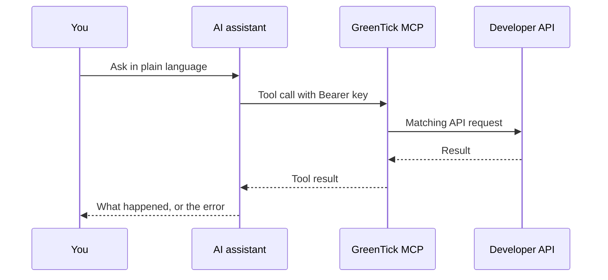

The GreenTick MCP server lets an assistant use your WhatsApp Business account. It calls the Developer API with your API key. You describe the job in plain language. The assistant discovers the tools, calls them, and reports the result.

The server address is `https://api.greentick.ai/mcp`. That host is the WhatsApp server. The `/mcp` path on this docs site is a separate search server for the documentation, and it cannot send WhatsApp messages.

The server is included on Starter, Standard, and Premium. An expired plan rejects every tool call with `PLAN_EXPIRED`.

## How it works



GreenTick sends a fixed set of instructions with the server. The assistant does not send, publish, schedule, enroll, or enable anything until you ask for that action in the conversation. Those stop conditions are written out in [Rules](/mcp/rules).

## What you can ask it to do

| Job | Where to start |
| --- | --- |
| Reply in an open chat, send or schedule a template | [Messages](/mcp/messages) |
| Submit a template, or generate a header image | [Templates](/mcp/templates) |
| Upload a file you already have | [Media](/mcp/media) |
| Save, publish, or enroll a workflow | [Automations](/mcp/automations) |
| Publish a WhatsApp Flow and read submissions | [Flows](/mcp/flows) |
| Create a bot, test it, then enable it | [AI bots](/mcp/ai-bots) |
| Preview a recipient count, then schedule a broadcast | [Broadcasts](/mcp/broadcasts) |
| Read Live Chat, assign a thread, or send media and products | [Inbox](/mcp/inbox) |
| Create contacts, labels, and attributes | [Contacts](/mcp/contacts) |
| Add a catalog product, or send a click-to-WhatsApp conversion | [Catalogs and ads](/mcp/catalogs) |

Each job also has its own page under [Use cases](/mcp/examples). Those pages are separate URLs, with the prompt to paste and the tools the assistant calls.

## Authentication

Create a key in **Developer**. The secret starts with `gt_live_` and is shown once. It belongs to the WhatsApp Business account you had selected.

Send it on every request as `Authorization: Bearer gt_live_…`. A bare key, without the `Bearer` prefix, is rejected. Do not put the key in the URL.

Client files for Claude, Cursor, and VS Code are on [Client setup](/mcp/client-setup).

A `GET` to `https://api.greentick.ai/mcp` without a key only reports that a server named `greentick` exists. Listing and calling tools still needs the Bearer key.

## Quick example

Ask:

```text
List my approved WhatsApp templates and tell me the name and language of each one. Do not send anything.
```

A connected assistant calls `list_templates` and returns the approved set. Sending one of those templates is a separate request, covered in [Send an approved template](/mcp/use-cases/send-approved-template).

## FAQ

<AccordionGroup>
  <Accordion title="Does the assistant send WhatsApp messages on its own?">
    No. `send_message`, `schedule_broadcast`, `publish_workflow`, `publish_flow`, `send_flow`, `enroll_automation`, and `enable_ai_bot` run only after you ask for that action in the conversation. Reading tools, such as `list_templates` and `list_contacts`, do not need a separate yes.
  </Accordion>
  <Accordion title="The Integrations card says MCP is coming soon. Can I connect anyway?">
    Yes. Connect `https://api.greentick.ai/mcp` yourself with an API key. You do not wait for that card. See [Client setup](/mcp/client-setup).
  </Accordion>
  <Accordion title="What happens when the plan expires or the key is revoked?">
    An expired plan returns `403` with `PLAN_EXPIRED`. The assistant does not retry until you renew on **Manage Plan**. A missing or revoked key returns `401` with `UNAUTHORIZED`. Create a new key in **Developer** and update the client header.
  </Accordion>
  <Accordion title="Do I need a separate model API key?">
    No. Claude, Cursor, or whichever client you use provides the model. GreenTick only checks the `gt_live_` key.
  </Accordion>
</AccordionGroup>
