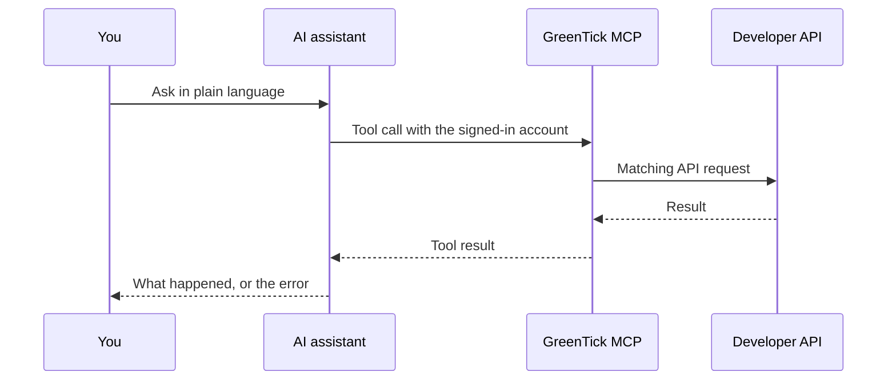

The GreenTick MCP server lets an assistant use your WhatsApp Business account. It calls the Developer API with your API key. You describe the job in plain language. The assistant discovers the tools, calls them, and reports the result.

The server address is `https://api.greentick.ai/mcp`. Connecting it asks you to sign in as the GreenTick account owner. A Developer API key cannot open this connection. That host is the WhatsApp server. The `/mcp` path on this docs site is a separate search server for the documentation, and it cannot send WhatsApp messages.

The server is included on Starter, Standard, and Premium. An expired plan rejects every tool call with `PLAN_EXPIRED`.

## How it works



GreenTick sends a fixed set of instructions with the server. The assistant does not send, publish, schedule, enroll, or enable anything until you ask for that action in the conversation. Those stop conditions are written out in [Rules](/mcp/rules).

## What you can ask it to do

| Job | Where to start |
| --- | --- |
| Reply in an open chat, send or schedule a template | [Messages](/mcp/messages) |
| Submit a template, or generate a header image | [Templates](/mcp/templates) |
| Upload a file you already have | [Media](/mcp/media) |
| Save, publish, or enroll a workflow | [Automations](/mcp/automations) |
| Publish a WhatsApp Flow and read submissions | [Flows](/mcp/flows) |
| Create a bot, test it, then enable it | [AI bots](/mcp/ai-bots) |
| Preview a recipient count, then schedule a broadcast | [Broadcasts](/mcp/broadcasts) |
| Read Live Chat, assign a thread, or send media and products | [Inbox](/mcp/inbox) |
| Find a teammate or team id before assigning a chat | [Team](/mcp/team) |
| Read the current plan, usage, or invoices | [Plan](/mcp/plan) |
| Create contacts, labels, and attributes | [Contacts](/mcp/contacts) |
| Add a catalog product, or send a click-to-WhatsApp conversion | [Catalogs and ads](/mcp/catalogs) |

Each job also has its own page under [Use cases](/mcp/examples). Those pages are separate URLs, with the prompt to paste and the tools the assistant calls.

## Authentication

Add the server in Claude, Cursor, VS Code, or Claude Code. The client sends you to GreenTick to sign in. Only the owner of the WhatsApp Business accounts can finish that screen. One sign-in covers every account that owner owns. The consent screen asks which account to use when a message does not name one.

A `gt_live_` Developer API key is rejected on `https://api.greentick.ai/mcp`. Those keys still work on the Developer API at `/v1`.

Client steps are on [Client setup](/mcp/client-setup).

A request to `https://api.greentick.ai/mcp` without a signed-in session returns `401`. That response is what starts the sign-in.

## Quick example

Ask:

```text
List my approved WhatsApp templates and tell me the name and language of each one. Do not send anything.
```

A connected assistant calls `list_templates` and returns the approved set. Sending one of those templates is a separate request, covered in [Send an approved template](/mcp/use-cases/send-approved-template).

## FAQ

<AccordionGroup>
  <Accordion title="Does the assistant send WhatsApp messages on its own?">
    No. `send_message`, `schedule_broadcast`, `publish_workflow`, `publish_flow`, `send_flow`, `enroll_automation`, and `enable_ai_bot` run only after you ask for that action in the conversation. Reading tools, such as `list_templates` and `list_contacts`, do not need a separate yes.
  </Accordion>
  <Accordion title="The Integrations card says MCP is coming soon. Can I connect anyway?">
    Yes. Add `https://api.greentick.ai/mcp` and sign in as the account owner. You do not wait for that card. See [Client setup](/mcp/client-setup).
  </Accordion>
  <Accordion title="What happens when the plan expires or the sign-in ends?">
    An expired plan returns `403` with `PLAN_EXPIRED`. The assistant does not retry until you renew on **Manage Plan**. A missing or expired sign-in returns `401` with `UNAUTHORIZED`. Connect the server again and sign in.
  </Accordion>
  <Accordion title="Do I need a separate model API key?">
    No. Claude, Cursor, or whichever client you use provides the model. GreenTick checks the sign-in from the connect screen.
  </Accordion>
</AccordionGroup>
